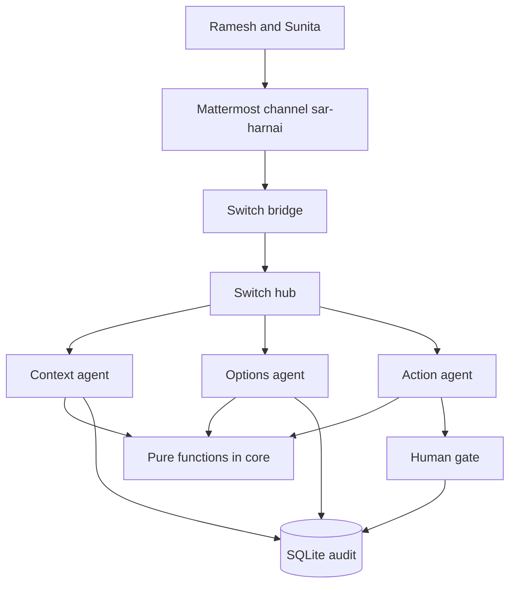

# Architecture

SeaSwarm is one Mattermost channel, a Switch process in front of it, three Python agents, and a SQLite file. The agents subscribe to the room over server-sent events and answer over HTTP. Humans speak in Mattermost. The bridge copies those posts onto the Switch hub, and copies agent replies back.

Numbers come from pure functions in `core/`. Drift, sector coverage, fuel, cost, daylight margin, risk flags, and scheme eligibility are computed before any sentence is written. The model, when a key is configured, may only rephrase a reply that still contains those figures. `SEASWARM_SEED` fixes the small random phase of the drift polygon so a demo can be repeated. The cone center does not depend on the seed.

## The room

Context listens for "overdue", "SOS", "not back", and "missing". It loads the boat, the last position, the mock wind and tide, and posts the drift cone. Options turns that cone into three sectors and three plans, and it re-plans when someone clears a sector, reassigns a boat, or rejects option B. It refuses a second boat on a sector that already has one, and it says so in the thread. Action drafts the escalation, runs the scheme rules, pins the checklist, and asks again on the follow-up interval. The default interval is 30 minutes. The demo does not wait that long. The checklist shows the next prompt from the scenario clock.
