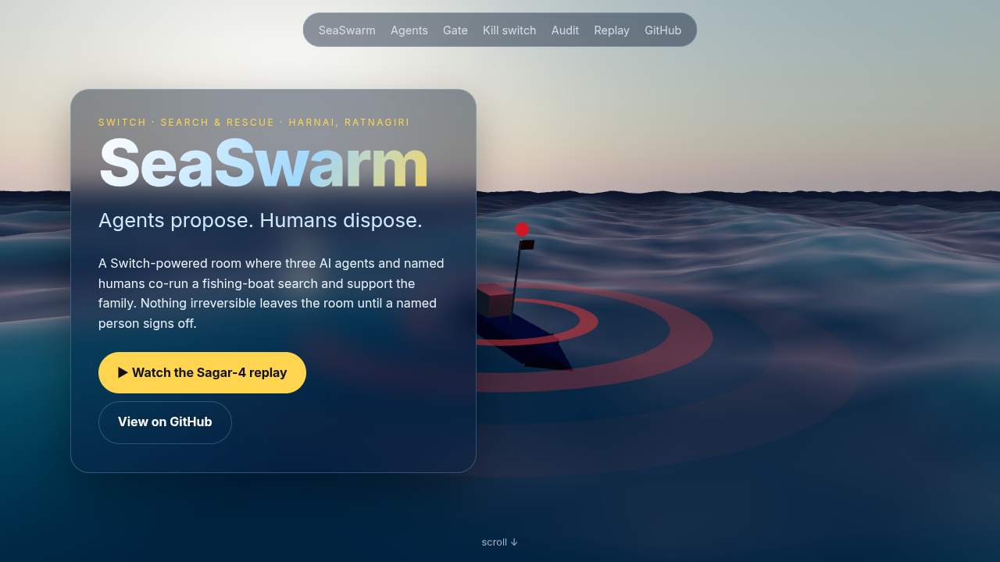
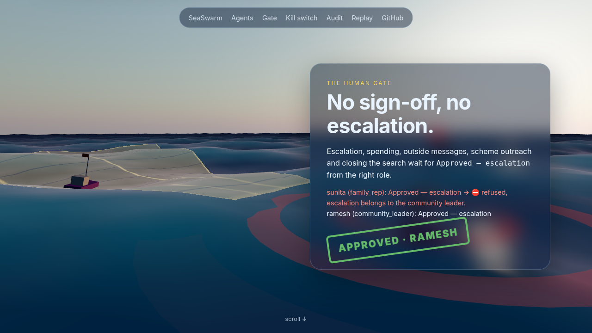
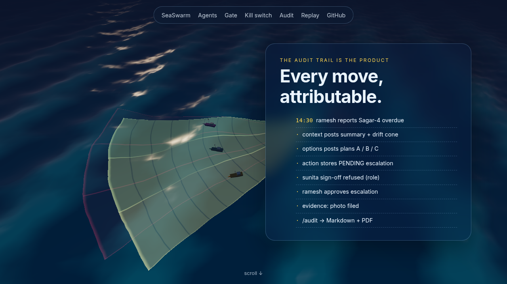
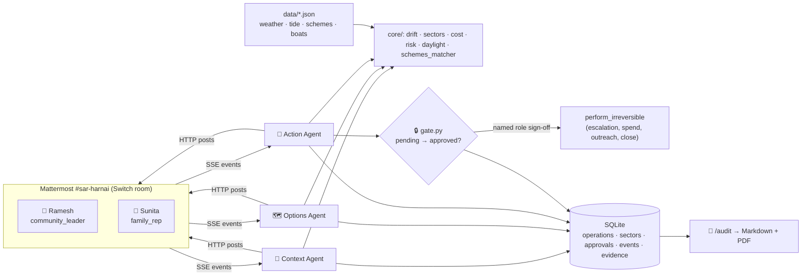
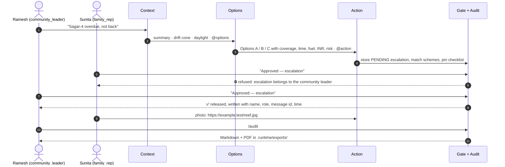

<p align="center"></p>

<p align="center">
<a href="https://git.io/typing-svg"></a>
</p>

<p align="center">
<a href="https://aneek22112007-tech.github.io/seaswarm/"></a>
<a href="https://github.com/aneek22112007-tech/seaswarm/actions/workflows/ci.yml"></a>


<a href="LICENSE"></a>

</p>

<h3 align="center">A Switch-powered coordination room for fishing-boat search-and-rescue and family support in coastal Maharashtra.</h3>

<p align="center"><a href="https://aneek22112007-tech.github.io/seaswarm/"><b>🌊 Open the 3D landing page</b></a> · <a href="https://aneek22112007-tech.github.io/seaswarm/replay/"><b>▶ Sagar-4 replay</b></a></p>

<p align="center"><a href="https://aneek22112007-tech.github.io/seaswarm/"></a> <a href="https://aneek22112007-tech.github.io/seaswarm/#gate"></a> <a href="https://aneek22112007-tech.github.io/seaswarm/#audit"></a></p>

---

When a boat is overdue, the village WhatsApp/Telegram group is where everyone already is, and it's where coordination breaks: the last-known position gets buried, boats search the same stretch twice, and nobody can say who approved the Coast Guard call. **SeaSwarm turns that same chat into a governed, auditable operations room.**

| | Agent | What it does |
|---|---|---|
| 🧭 | **Context** | Who is missing, since when, last fix, heading, drift cone, daylight left. Tags `@options`. |
| 🗺️ | **Options** | Exactly 3 search plans with coverage, time, fuel, INR cost, daylight margin and risk flags. Re-plans live; never sends two boats to one sector. Tags `@action`. |
| 🛟 | **Action** | Coast Guard / marine police escalation stored as *pending*, fishermen-welfare & insurance matching, pinned checklist, photo/GPS evidence. |

> [!IMPORTANT]
> 🔒 **Human gate:** nothing irreversible (escalation, spending, outside messages, scheme outreach, closing the search) happens until a named human with the right role replies `Approved — <action>`. Wrong role? The thread refuses it on screen.
>
> 📜 **The audit trail is the product.** Every assignment, correction and sign-off is timestamped and attributable. `/audit` exports Markdown + PDF.
>
> 🧪 **Deterministic.** Every number comes from pure functions in `core/`; the LLM only phrases it. 121 tests passing.

<p align="center"></p>

## 🚀 Quickstart

```bash
git clone https://github.com/aneek22112007-tech/seaswarm && cd seaswarm
make up      # builds and waits for Postgres, Mattermost, Switch and the three agents
make demo    # seeds the register and replays the Sagar-4 search
```

- Mattermost: http://localhost:8065 · Switch console: http://localhost:8090
- Team `seaswarm`, channel `sar-harnai`
- `ramesh` / `SeaSwarm-Ramesh-2026!` (community leader) · `sunita` / `SeaSwarm-Sunita-2026!` (family representative)

`LLM_API_KEY` is optional: leave it empty and the room hears the same figures in fallback wording. Leave `MATTERMOST_BOT_TOKEN` empty and Switch creates the bots on boot. `make down` stops, `make test` / `make lint` run pytest, ruff and black.

## 🏗️ Architecture



## 🎬 Demo: Sagar-4

Sagar-4, three crew, out of Harnai in Ratnagiri, is overdue by two hours. The last radio fix is a reef 6 km offshore. Four hours of daylight remain. The room clock is 15 January 2026, 14:30 IST.



<details>
<summary><b>📋 Plans the Options agent computes for the seeded room</b></summary>

| Option | Boats | Sectors | Time | Fuel | Cost | Daylight margin |
|---|---|---|---|---|---|---|
| A | Meerabai | Sector-2 | 1.45 h | 4.1 L | INR 389.50 | 2.55 h |
| B | Meerabai, Chandra-2 | Sector-2, Sector-1 | 1.65 h | 9.4 L | INR 893.00 | 2.35 h |
| C | Meerabai, Chandra-2, Harnai-Queen | all three | 1.95 h | 16.7 L | INR 1586.50 | 2.05 h |

Room commands: `reject option B`, `Sector-1 clear`, `reassign Meerabai to Sector-1`. The sign-off line uses an em dash; a hyphen does not count.
</details>

<details>
<summary><b>🔒 The human gate in detail</b></summary>

`agents/common/roles.py` maps Mattermost usernames to `community_leader`, `boat_owner`, `family_rep` and `volunteer`. Every irreversible action goes through `agents/common/gate.py` and is stored as a pending approval. The irreversible set is escalation, spending money, a message that leaves the room, scheme outreach and closing the search. Scheme outreach can be signed by the community leader or the family representative; the other four require the community leader.

`perform_irreversible` is the only release. It raises if the approval row is missing, pending or rejected, and refuses a second release of the same row. `tests/test_gate.py` and the action-agent test prove a pending escalation cannot run.
</details>

## 🔌 The kill switch

`make killswitch` runs the same two planning passes with and without room persistence:

| | `PERSISTENCE=on` ✅ | `PERSISTENCE=off` 💥 |
|---|---|---|
| Sectors after two passes | 3 (Sector-1/2/3 ×1) | **6** (each ×2) |
| Stored approvals | 1, approver `ramesh` | **0** |
| Sign-off reply | "ramesh (community_leader) approved escalation." | "No pending approval for escalation. The sign-off was not applied." |

Logs: [`logs/persistence-on.txt`](logs/persistence-on.txt) · [`logs/persistence-off.txt`](logs/persistence-off.txt). Remove the room and the operation collapses. **That is why Switch is the product.**

<details>
<summary><b>📜 Audit export</b></summary>

`/audit` in the room, and `make audit` on the host, write a timestamped Markdown file and a PDF listing the operation, sector assignments, every sign-off with approver and message id, the evidence, and the append-only event log.
</details>

<details>
<summary><b>💬 Optional Telegram / Discord doors</b></summary>

Off unless `TELEGRAM_ENABLED` or `DISCORD_ENABLED` is set. Start with `docker compose --profile adapters up -d adapters` (port 8091). A forwarded line keeps the sender's username, so `ramesh` on Telegram has the same role as in Mattermost.
</details>

## 🧰 Tech stack

<p>


</p>

## 🌐 Deploy

A single VPS with Docker and Caddy. The Caddyfile, systemd unit and steps are in [deploy/VPS.md](deploy/VPS.md). The 3D landing page (Three.js Gerstner ocean, GSAP scroll story, no build step) lives in [`docs/`](docs/) and is served by GitHub Pages at **https://aneek22112007-tech.github.io/seaswarm/**; the 2D replay is at [`/replay/`](https://aneek22112007-tech.github.io/seaswarm/replay/).

## 🌍 Impact & track fit

- **UN SDG 14 (Life Below Water)** and disaster management for small-scale fishers.
- One governance template (agents propose, humans dispose) for flood response, factory safety and health-worker rooms.
- **Best Business Workflow** (primary) · **Best Blog**: [BLOG.md](BLOG.md) · **Code with Wispr**.
- More detail: [ARCHITECTURE.md](ARCHITECTURE.md).

<p align="center"></p>

<p align="center">MIT © aneek22112007-tech</p>
